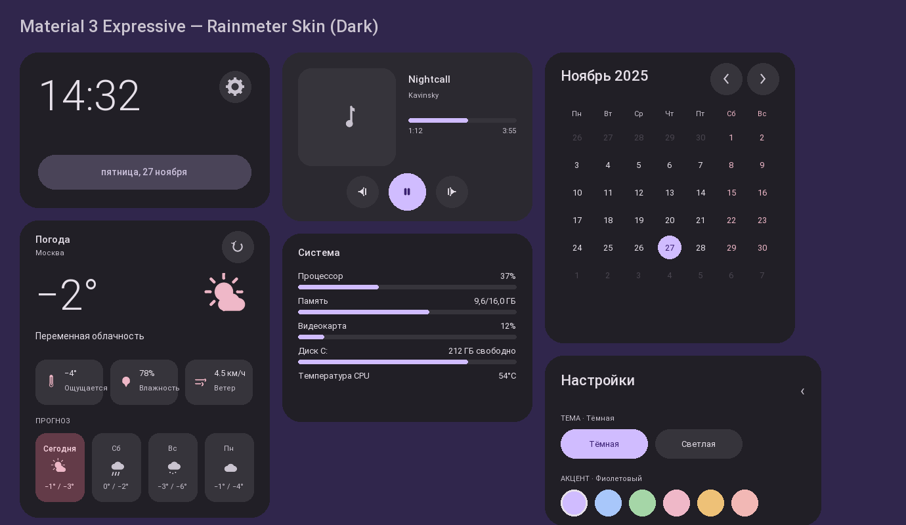

# Material 3 Expressive — Rainmeter Skin

Набор виджетов для **Rainmeter 4.5+** (Windows 10/11) в стиле **Google Material 3 Expressive**: выразительная типографика, крупные скруглённые поверхности разных уровней, мягкие цветовые акценты и модульная архитектура. Реализован полностью нативными средствами Rainmeter (.ini/.inc/.lua + Shape/Image/Bar) — без HTML, WebView и Electron.



*Превью сгенерировано по реальным размерам и палитре скинов; фактический внешний вид на рабочем столе — живые данные (время, погода Open-Meteo, Now Playing, системные счётчики).*

## Состав

| Виджет | Файл | Что показывает |
|---|---|---|
| **Clock** | `Widgets\Clock.ini` | Крупные цифровые часы (12/24 ч), дата, день недели, кнопка настроек |
| **Weather** | `Widgets\Weather.ini` | Температура, описание, ощущаемая, влажность, ветер, прогноз на 4 дня — реальный API [Open-Meteo](https://open-meteo.com) |
| **Music** | `Widgets\Music.ini` | Обложка, название, исполнитель, прогресс с перемоткой кликом, Play/Pause, Next/Prev через `Measure=NowPlaying` |
| **System** | `Widgets\System.ini` | CPU, RAM, GPU (UsageMonitor, Win10 FCU+), до 2 дисков, температура CPU (Core Temp) |
| **Calendar** | `Widgets\Calendar.ini` | Полная сетка 6×7, неделя с понедельника, выделение сегодняшнего дня, навигация по месяцам |
| **Settings** | `Settings\Settings.ini` | Тема, акцент, прозрачность, скругления, масштаб, формат времени, город |

Каждый виджет — **самостоятельный скин**: включается, отключается и перемещается независимо.

## Установка

1. Установите [Rainmeter 4.5+](https://www.rainmeter.net/) (портативная или обычная версия).
2. Скопируйте папку `MaterialExpressive` в `Documents\Rainmeter\Skins\`:
   - вручную, либо двойным кликом по `.rmskin`, если пакет собран из этой папки;
   - путь в итоге: `Documents\Rainmeter\Skins\MaterialExpressive\Widgets\Clock.ini` и т.д.
3. Обновите список скинов: правый клик по иконке Rainmeter в трее → **Refresh All** (или `!RefreshApp`).
4. Откройте менеджер скинов → `MaterialExpressive` и включите нужные виджеты.
5. Откройте `Settings` (кнопка-шестерёнка на часах или менеджер скинов) и настройте тему, акцент, город и т.д.

Шрифт **Roboto** включён в `@Resources\Fonts` и подхватывается Rainmeter автоматически — устанавливать в систему его не нужно.

## Настройка

Основные настройки меняются через скин **Settings** (применяются ко всем виджетам мгновенно через `!RefreshApp`):

- **Тема**: Тёмная / Светлая.
- **Акцент**: 6 пресетов (Фиолетовый, Синий, Зелёный, Розовый, Янтарный, Коралловый).
- **Прозрачность поверхностей**: 100–60%.
- **Скругления**: 8 / 16 / 28 / 40 px.
- **Масштаб**: 85–130% (применяется ко всей геометрии и шрифтам).
- **Формат времени**: 24 ч / 12 ч.
- **Город погоды**: 6 пресетов; произвольный город — правкой `City`, `Latitude`, `Longitude` в `@Resources\User\User.inc` (координаты можно взять на [open-meteo.com](https://open-meteo.com), там же есть геокодер).

Дополнительные параметры в `@Resources\User\User.inc` (или во вкладке Rainmeter → Manage → Skins → правка переменных):

```ini
MusicPlayer=WMP     ; WMP | AIMP | CAD | MusicBee | iTunes | Winamp
Disk1=C:
Disk2=D:            ; если диска нет — строка «Диск D:» автоматически скрывается
WeatherRefresh=30   ; интервал запроса погоды, минуты
```

### Где хранится состояние

Все пользовательские значения пишутся скином Settings в `@Resources\User\User.inc` (кодировка UTF-16 LE BOM, поддерживается `!WriteKeyValue`). Этот файл подключается **первым**, поэтому его значения перекрывают дефолты из `Variables.inc`, а активная тема `@Resources\Themes\dark.inc`/`light.inc` подгружается через динамический `@Include`:

```ini
@Include1=#@#User\User.inc
@Include2=#@#..\Variables.inc
@Include3=#@#Themes\#Theme#.inc
@Include4=#@#..\Styles.inc
```

## Плагины и зависимости

Используются **только встроенные плагины Rainmeter** — ничего доустанавливать не нужно:

| Мера | Где | Назначение |
|---|---|---|
| `Measure=CPU`, `PhysicalMemory`, `FreeDiskSpace` | System | Нативные счётчики |
| `Plugin=UsageMonitor` (Alias=GPU) | System | Загрузка GPU (Win10 Fall Creators Update+) |
| `Plugin=CoreTemp` | System | Температура CPU; нужен запуск [Core Temp](https://www.alcpu.com/CoreTemp/) с включённым плагином. Если Core Temp не запущен — показывается «—» |
| `Measure=NowPlaying` | Music | Windows-плееры: WMP, AIMP, MusicBee, iTunes, Winamp, CAD-совместимые |
| `Plugin=WebParser` | Weather | Один HTTP-запрос к Open-Meteo раз в `WeatherRefresh` минут |
| `Measure=Script` (Lua) | Calendar | Расчёт сетки календаря |

### Про NowPlaying

Rainmeter не имеет прямого доступа к Windows Media Session API, поэтому `Measure=NowPlaying` работает с поддерживаемыми плеерами (см. таблицу выше). Для Spotify/браузеров можно подключить сторонний плагин [WebNowPlaying](https://github.com/keifufu/WebNowPlaying-Rainmeter) — в этом случае смените в `User.inc`:

```ini
MusicPlayer=WebNowPlaying
```

## API погоды

- Провайдер: [Open-Meteo](https://open-meteo.com/v1/forecast) — бесплатный, без ключа API.
- Один запрос: текущая погода (`current`) + 4 дня прогноза (`daily`), `timezone=auto`.
- Частота запросов: раз в `WeatherRefresh` минут (по умолчанию 30); кнопка «обновить» форсирует `Refresh` меры WebParser.
- Коды погоды (WMO) переводятся в русские описания и иконки через `Substitute` — без Lua и лишних мер.

## Совместимость

- **Windows 10/11**, Rainmeter **4.5+**.
- GPU-счётчик `UsageMonitor` (категория GPU Engine): Windows 10 Fall Creators Update и новее; на старых системах строка «Видеокарта» покажет 0%.
- Температура CPU требует запущенного Core Temp; без него — «—».
- Кириллица: все `.ini`/`.inc`/`.lua` сохранены в **UTF-16 LE с BOM** (требование Rainmeter), корректно работают на любой системной локали. Названия месяцев в календаре заданы явно в `@Resources\Scripts\Calendar.lua` и не зависят от локали Windows.

## Производительность

- Weather: `Update=60000` × `UpdateDivider=WeatherRefresh` → один сетевой запрос в 30 минут.
- System: CPU/RAM/GPU — раз в 2 с, диски — раз в 30–60 с, температура — раз в 10 с.
- Clock: время раз в секунду, дата — раз в минуту.
- Calendar: пересчёт раз в минуту (и при навигации), вся сетка задаётся одним Lua-скриптом через `!SetOption`.
- Иконки — PNG 96×96, масштабируются средствами Rainmeter; тяжёлых изображений нет.
- Никаких WebView/браузерных движков.

## Архитектура

```text
MaterialExpressive/
├── Variables.inc            # общие дефолты (масштаб, формат времени, город, диски…)
├── Styles.inc               # общие стили метр (типографика, кнопки, бары)
├── Settings/Settings.ini    # панель настроек (пишет User.inc + !RefreshApp)
├── Widgets/                 # независимые скины
│   ├── Clock.ini
│   ├── Weather.ini
│   ├── Music.ini
│   ├── System.ini
│   └── Calendar.ini
└── @Resources/
    ├── User/User.inc        # состояние пользователя (перезаписывается Settings)
    ├── Themes/dark.inc      # тёмная схема (RGB-роли + SurfaceAlpha)
    ├── Themes/light.inc     # светлая схема
    ├── Scripts/Calendar.lua # расчёт сетки календаря
    ├── Fonts/               # Roboto (Regular/Medium/Bold/Light)
    ├── Icons/               # PNG-иконки (тонируются ImageTint)
    └── Cache/               # обложки NowPlaying
```

Принципы:

- **Цвета централизованы**: темы хранят RGB-роли (десятичные), акценты — в `User.inc` (hex). В метрах значения цветов не дублируются — только переменные.
- **Без вложенных переменных**: значения переменных — литералы; вся масштабная арифметика (`* #ScalePct# / 100`) — в формулах опций метр.
- **Прозрачность**: темы дают RGB, альфа подставляется формульно `(#SurfaceAlpha#)` — переключение прозрачности не трогает цвета.
- **Кнопки**: Shape-подложка + hover-оверлей (показ/скрытие) + иконка; клики по метрам без действий «проваливаются» вниз, поэтому активна вся площадь кнопки.

## Лицензия

Код скинов — Creative Commons BY-NC-SA 4.0. Шрифт Roboto — Apache License 2.0 (Google). Данные погоды — Open-Meteo (CC BY 4.0).
